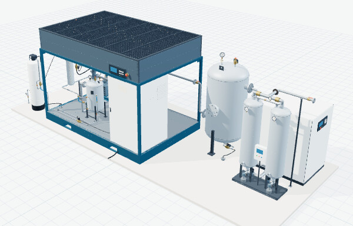
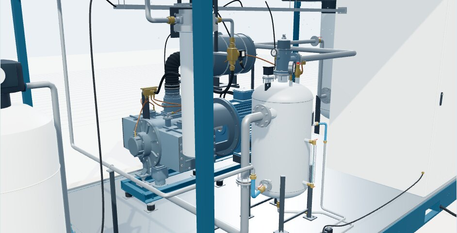
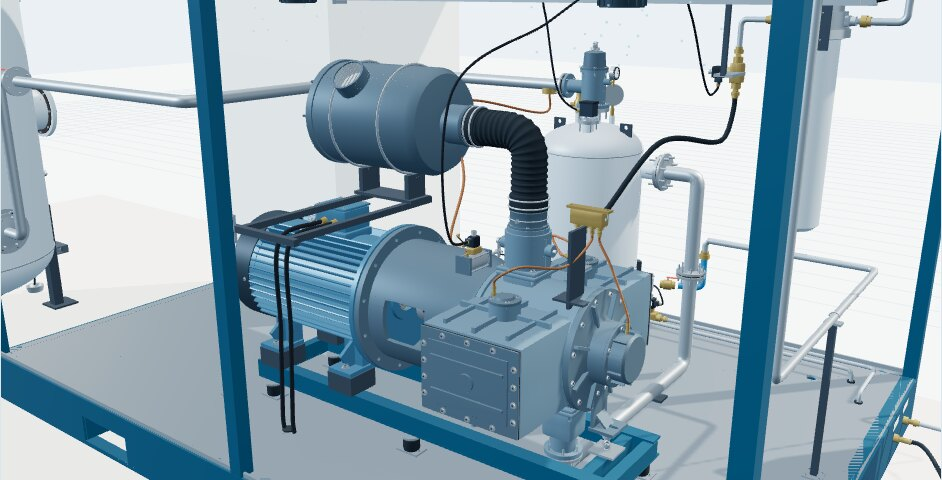
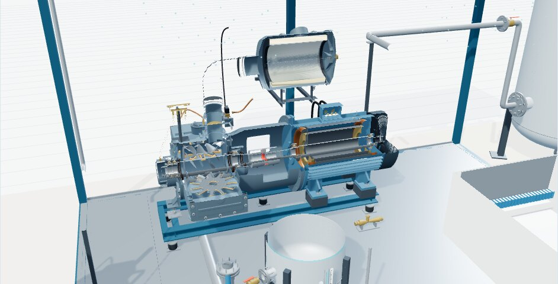
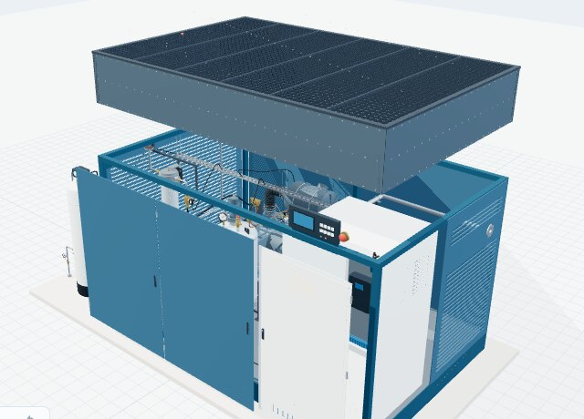

# Máy nén khí trục vít đơn phun nước — mô hình Three.js

Mô hình 3D máy nén khí trục vít đơn (một trục vít, hai bánh sao), không dầu trong buồng nén, dùng nước bôi trơn – làm kín – giải nhiệt, giải nhiệt bằng két gió có quạt. Gồm **trạm hoàn chỉnh** và 18 cụm riêng: đầu nén, động cơ, bình tách, két, khung – tủ điện, van, lọc, cụm nước bù – làm mềm, bình tích áp, máy sấy lạnh, máy sấy hấp phụ. Viết bằng HTML/JavaScript thuần với Three.js 0.180, chạy offline, xuất được GLB.

- **Mở ngay:** nhấp đúp `MO-NGAY.html` (Chrome/Edge có WebGL 2). Trình xem mở sẵn trạm hoàn chỉnh.
- **Sửa mã:** chạy `python3 run.py` rồi mở `index.html`.
- **Hướng dẫn đầy đủ, tham số, giả định và giới hạn:** [HUONG-DAN.md](HUONG-DAN.md).



| Bên trong gói máy, phía trước | Phía sau: đầu nén, động cơ, lọc khí |
| --- | --- |
|  |  |
| **Mặt cắt trạm** | **Có vỏ bao che, tách cụm** |
|  |  |

| Trục vít và hai bánh sao | Đầu nén, mặt cắt |
| --- | --- |
|  |  |
| **Động cơ và nắp quạt** | **Bình tách, mặt cắt** |
|  |  |

## Điểm chính của bản 3.0

- **Trạm hoàn chỉnh** (`station`) ghép 16 cụm theo bố trí H1: đầu nén – động cơ trên giá chống rung và ghế đỡ, van hút, van một chiều, ống chính chữ U, bình tách, van áp suất tối thiểu, lọc khí và ống mềm hút, két nóc hai quạt, lọc nước, van ngắt nước, bộ chia và bốn ống chia vào đầu nén, tủ điện, máng cáp và cáp, nước bù – làm mềm và đường xả theo H7, chuỗi bình tích áp → máy sấy lạnh → máy sấy hấp phụ.
- Vị trí và ống nối tính từ **cổng nối** của từng cụm; phép thử xác nhận các mặt ghép trực tiếp trùng khít và vòng nước, tuyến khí nối đúng cổng.
- Tham số trạm: khung hở / có vỏ bao che, chiều gió qua két, có hay không thiết bị ngoài.
- Các cụm còn lại được nâng chi tiết cùng mức với đầu nén, động cơ, bình tách.
- Giữ các ràng buộc: một trục vít hai bánh sao trục vuông góc; bình tách khác bình tích áp; két trên nóc, hai quạt dưới két; không thêm bộ trao đổi nhiệt dạng tấm, không bơm, không RO; lọc H10 là phương án riêng, không ghép; kết cấu không có bản vẽ gắn nhãn **minh họa**.

## Lệnh

```bash
node --test tests/models.test.mjs   # kiểm tra (15 phép thử)
node export-models.mjs              # xuất 18 cụm + trạm thành GLB vào models-glb/
python3 build-standalone.py         # dựng lại MO-NGAY.html
```

Kích thước là ước lượng từ ảnh không ghi kích thước (trạm: 1 đơn vị ≈ 100 mm); không dùng để gia công hay tính chọn thiết bị.
