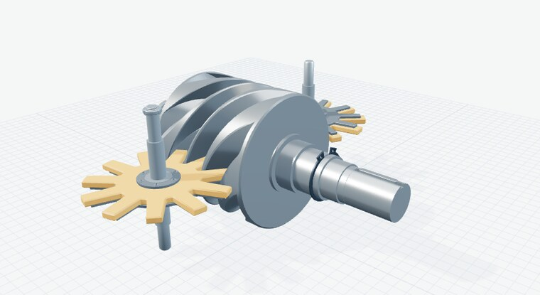
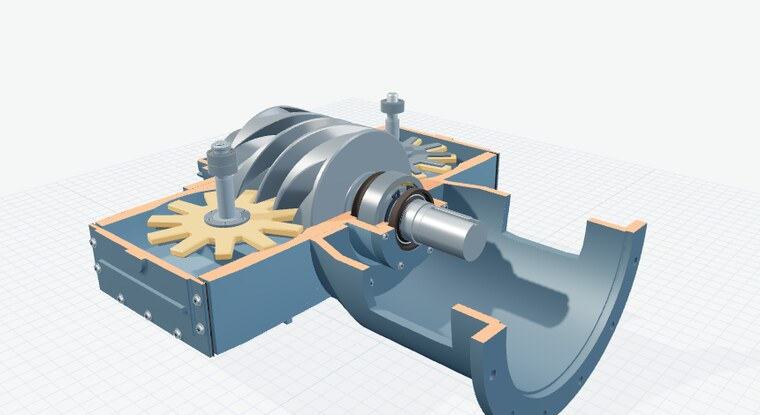
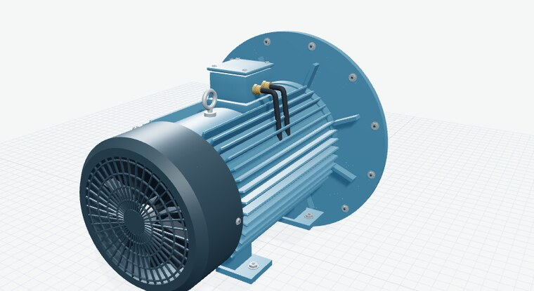
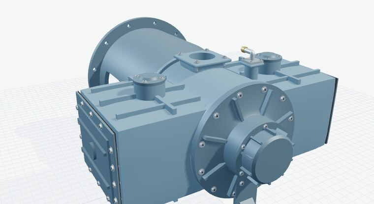
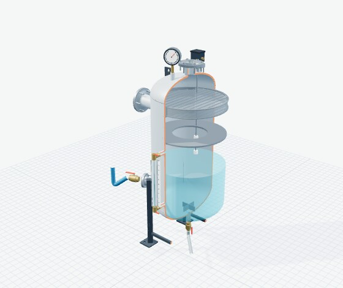

# Máy nén khí trục vít đơn phun nước — mô hình Three.js

Thư viện 18 cụm 3D của máy nén khí trục vít đơn (một trục vít, hai bánh sao), không dầu trong buồng nén, dùng nước bôi trơn – làm kín – giải nhiệt, giải nhiệt bằng két gió có quạt; kèm bình tích áp, máy sấy lạnh và máy sấy hấp phụ bên ngoài. Viết bằng HTML/JavaScript thuần với Three.js 0.180, chạy offline, xuất được GLB.

- **Mở ngay:** nhấp đúp `MO-NGAY.html` (Chrome/Edge có WebGL 2).
- **Sửa mã:** chạy `python3 run.py` rồi mở `index.html`.
- **Hướng dẫn đầy đủ, tham số, giả định và giới hạn:** [HUONG-DAN.md](HUONG-DAN.md).

| Trục vít và hai bánh sao | Đầu nén, mặt cắt |
| --- | --- |
|  |  |
| **Động cơ và nắp quạt** | **Đầu nén, phía xả** |
|  |  |



## Điểm chính của bản 2.0

- Rãnh trục vít **sinh theo động học** từ răng bánh sao (tỷ số z1/z2), răng hai bánh sao luôn nằm trong rãnh khi quay; phép thử tự động xác nhận không va chạm. Đây là mô hình động học lý tưởng, chưa phải biên dạng chế tạo.
- Vỏ đầu nén **rỗng có độ dày** dựng bằng CSG; chế độ mặt cắt cắt thật vỏ và tô màu mặt cắt.
- Động cơ có thân gân, mặt bích, chân đế, hộp đấu điện, đầu cáp, nắp quạt lưới nan, khớp nối hai nửa với đệm đàn hồi và nắp che tháo được.
- Bình tách có vỏ rỗng, chân, cổ nối, mặt bích, đồng hồ, van an toàn, công tắc mức, kính mức, van và đường nước.
- Cổng nối cho cả 18 cụm (trong mô hình, GLB và `models-glb/manifest.json`) để ghép hệ thống sau.
- Chiều gió qua két là tham số đảo được (bản vẽ không có mũi tên chỉ chiều).
- Kết cấu không có bản vẽ được gắn nhãn **minh họa**.

## Lệnh

```bash
node --test tests/models.test.mjs   # kiểm tra
node export-models.mjs              # xuất 18 GLB vào models-glb/
python3 build-standalone.py         # dựng lại MO-NGAY.html
```

Kích thước là ước lượng từ ảnh không ghi kích thước, đơn vị quy ước; không dùng để gia công hay tính chọn thiết bị.
